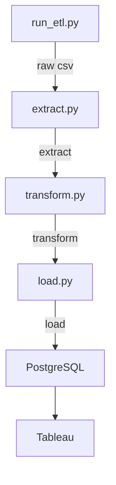
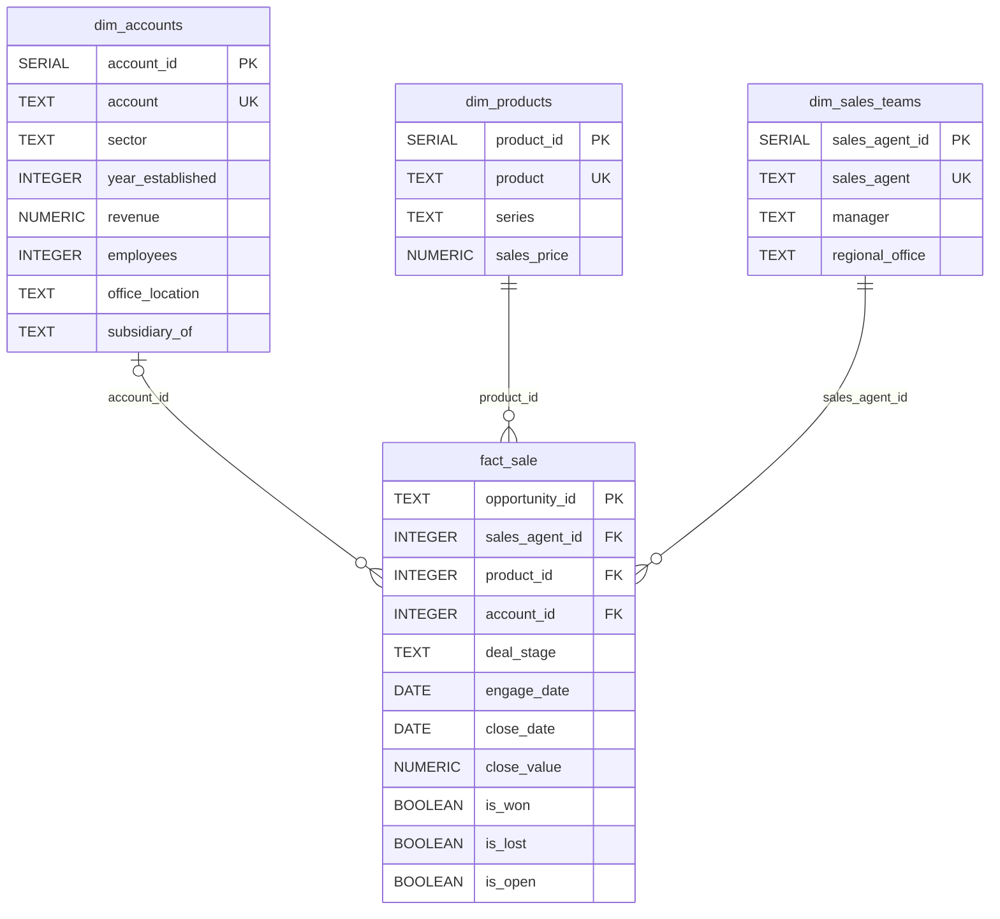
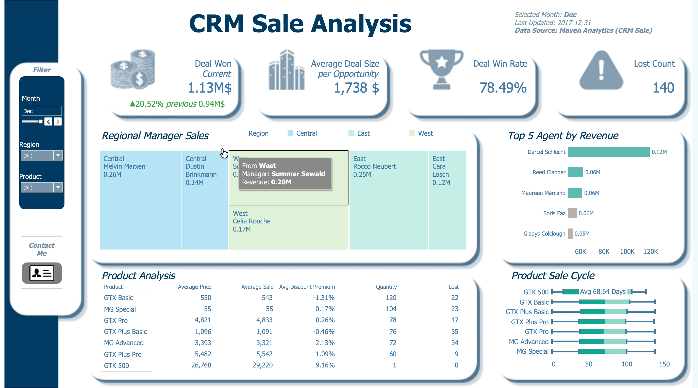

# CRM Sales ETL &mdash; Extract, Transform, Load to PostgreSQL + Tableau

A one-time migration pipeline that extracts raw CRM sales data from CSV/Excel exports,
cleans and transforms it with Python (pandas), loads it into PostgreSQL, and connects
Tableau Desktop for dashboarding.

> Source data: Maven Analytics Training Dataset (CRM Sales Opportunities) &mdash; a
> fictitious B2B computer-hardware company with accounts, products, sales teams, and
> sales opportunities.

## 📊 What's inside

| Component | Description |
|---|---|
| `etl/` | Modular Python ETL package (extract, transform, load, orchestrate) |
| `data/raw/` | Source CRM CSV exports (accounts, products, sales teams, pipeline) |
| `sql/schema.sql` | PostgreSQL target schema with foreign keys and indexes |
| `sql/eda.sql` | PostgreSQL EDA queries; depends on the tables created by `sql/schema.sql` and populated by the ETL |

## 🏗 Architecture



## 🔧 Transformations applied

- Column names normalized to `snake_case`
- Inconsistent product names standardized (`GTXPro` &rarr; `GTX Pro`)
- Dates parsed (`engage_date`, `close_date`)
- `close_value` cast to numeric
- Derived boolean flags for dashboards: `is_won`, `is_lost`, `is_open`
- Null logging on critical columns (`opportunity_id`, `deal_stage`, `account`, `product`, `sales_agent`)


## 🗄 Target schema (PostgreSQL)
**ER Diagram Star Schema**


Four tables, loaded in dependency order. Each dimension table has its own
auto-increment surrogate primary key; `fact_sale` connects only by those IDs:

- **`dim_accounts`** (PK `account_id`) &mdash; account, sector, year_established, revenue, employees, office_location, subsidiary_of
- **`dim_products`** (PK `product_id`) &mdash; product, series, sales_price
- **`dim_sales_teams`** (PK `sales_agent_id`) &mdash; sales_agent, manager, regional_office
- **`fact_sale`** (PK `opportunity_id`) &mdash; sales_agent_id, product_id, account_id, deal_stage, engage_date, close_date, close_value, is_won, is_lost, is_open

Foreign keys link `fact_sale` to each dimension via the surrogate IDs. Indexes on
`sales_agent_id`, `product_id`, `account_id`, `deal_stage`, `engage_date`, and
`close_date` support fast Tableau aggregations.

## 🚀 Quick start

### 1. Clone & create environment

```bash
git clone <your-repo-url>
cd crm-sales-etl
python -m venv .venv
source .venv/bin/activate        # Windows: .venv\Scripts\activate
pip install -r requirements.txt
```

### 2. Configure PostgreSQL credentials

Copy the example file and fill in your values:

```bash
cp .env.example .env
# edit .env with your PG_HOST, PG_PORT, PG_DBNAME, PG_USER, PG_PASSWORD
```

> `.env` is gitignored &mdash; never commit credentials.

### 3. Prepare the database

Create the target schema (optional &mdash; `etl/load.py` creates tables idempotently):

```bash
psql -h <host> -U <user> -d <dbname> -f sql/schema.sql
```

The EDA queries require the PostgreSQL tables to exist and contain data. After
running the ETL, execute [`sql/eda.sql`](sql/eda.sql) against the same database:

```bash
psql -h <host> -U <user> -d <dbname> -f sql/eda.sql
```

### 4. Run the ETL

```bash
python -m etl.run_etl
```

Expected output:

```
INFO | Extracted accounts.csv -> dim_accounts (85 rows, 7 cols)
INFO | Extracted products.csv -> dim_products (7 rows, 3 cols)
INFO | Extracted sales_teams.csv -> dim_sales_teams (35 rows, 3 cols)
INFO | Extracted sales_pipeline.csv -> fact_opportunities (8800 rows, 8 cols)
INFO | Loaded 85 rows into dim_accounts
INFO | Loaded 7 rows into dim_products
INFO | Loaded 35 rows into dim_sales_teams
INFO | Loaded 8800 rows into fact_sale
INFO | ETL complete. Total rows loaded: 8927
```

## 🔗 Connect Tableau Desktop

See [`docs/tableau_connection.md`](docs/tableau_connection.md) for the full walkthrough.

**Quick version:**
1. Tableau Desktop &rarr; Connect &rarr; To a Server &rarr; **PostgreSQL**
2. Enter host, port, database, user, password from `.env`
3. Drag the four tables onto the canvas
4. Build relationships on the surrogate IDs:
   - `fact_sale.sales_agent_id = dim_sales_teams.sales_agent_id`
   - `fact_sale.product_id = dim_products.product_id`
   - `fact_sale.account_id = dim_accounts.account_id`
5. Build dashboards: pipeline by deal stage, revenue by agent/region, win rate by product, quarterly trends.

## Tableau Public Link


link: https://public.tableau.com/views/CRM_sales/SaleAnalysis?:language=en-US&publish=yes&:sid=&:redirect=auth&:display_count=n&:origin=viz_share_link

---

## 📁 Project structure

```
crm-sales-etl/
├── .env.example              # credentials template (copy to .env)
├── .gitignore
├── LICENSE
├── README.md
├── requirements.txt          # Python dependencies
├── data/
│   └── raw/                  # source CRM CSV exports (gitignored data)
├── etl/
│   ├── __init__.py
│   ├── config.py             # paths + env settings
│   ├── extract.py            # read CSV/Excel into DataFrames
│   ├── transform.py          # cleaning + derived columns
│   ├── load.py               # PostgreSQL DDL + bulk insert
│   └── run_etl.py            # orchestration entry point
└── sql/
    ├── schema.sql            # PostgreSQL target DDL
    └── eda.sql               # PostgreSQL EDA queries & Data Validation (requires loaded tables)
```

---

## License

MIT

---

# Author
Name - Ye Zaw Myint  
email - yezaw5601@gmail.com  
contact - [https://yezaw.carrd.co](https://yezaw.carrd.co)  

---
